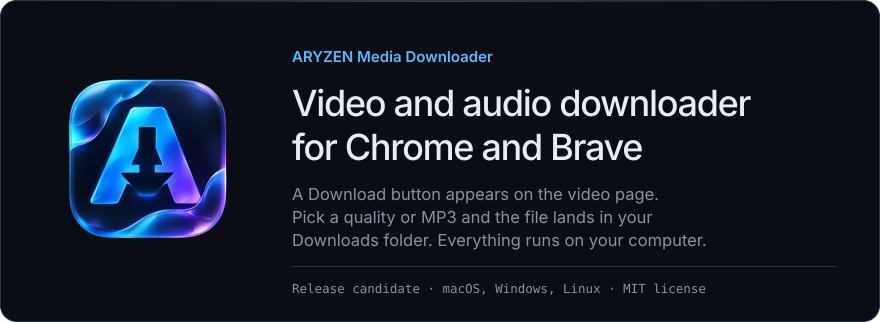
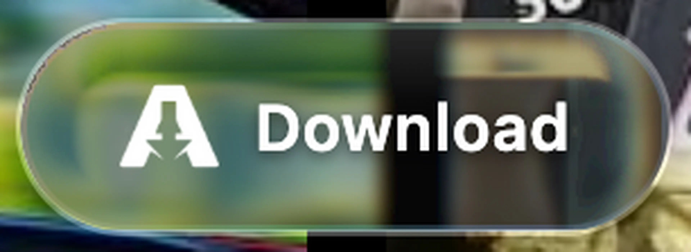
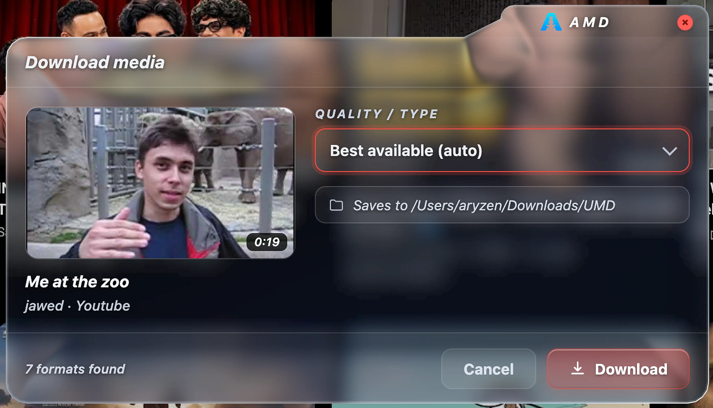
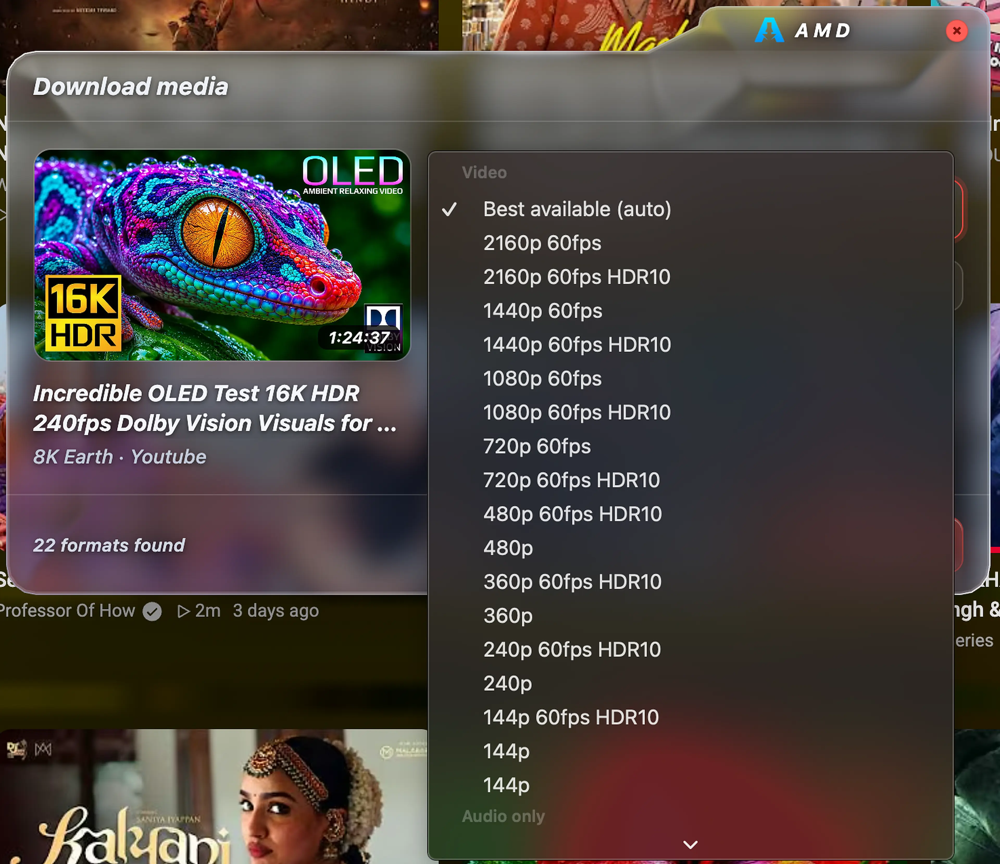
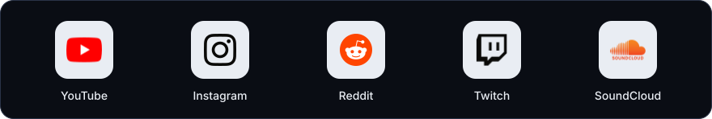
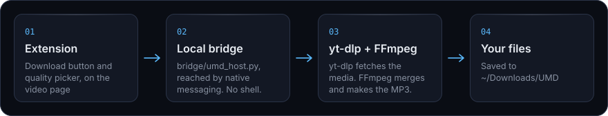

<a href="../../releases/latest"></a>&nbsp;<a href="#install"></a>

Built by **Aryzen Nex** on [yt-dlp](https://github.com/yt-dlp/yt-dlp), the download engine. Credit to the yt-dlp team and contributors: this project wraps their engine in a browser extension and a small local bridge.

## Download menu

The Download button floats over the video page.



Click it to open the menu. It shows the video, its length and source, a quality picker, and the folder the file saves to.



The picker lists every format yt-dlp finds, video qualities first, then audio only.



## Supported sites



Also supported: Streamable and TED.

## How it works



- A **browser extension** adds the Download button and quality picker to the supported sites.
- A tiny **local bridge** (`bridge/umd_host.py`) talks to the extension through native messaging and runs yt-dlp for you.
- **yt-dlp** fetches the media; **FFmpeg** merges video and audio and converts to MP3.

Everything runs locally on your machine. No accounts, no servers, no tracking.

## Install

### Requirements

| OS | What you need first |
| :-- | :-- |
| macOS | Nothing. The installer bundles a standalone Python runtime and FFmpeg, both checksum-verified. |
| Windows | Python 3.11+ on your PATH (python.org, tick "Add python.exe to PATH"). Current yt-dlp releases refuse to run on older Python (verified against yt-dlp 2026.10.26 on Python 3.10). FFmpeg and FFprobe are downloaded and checksum-verified by the installer. |
| Linux | `python3` 3.11+, `curl`, and `ffmpeg` (which includes `ffprobe`) from your package manager. The installer downloads no FFmpeg, because no static-build source we found publishes checksums; your distro's package is signature-verified. |

On Linux, install the packages with your package manager:

```sh
sudo apt install python3 curl ffmpeg      # Debian, Ubuntu
sudo dnf install python3 curl ffmpeg      # Fedora
sudo pacman -S python curl ffmpeg         # Arch
```

### Get the code

The easiest route is this repository's **Releases** page. Download the ZIP for your OS (Mac Apple Silicon, Mac Intel, Windows or Linux), unzip it, and run the installer file inside. Double-click it on macOS and Windows. On Linux, use the .desktop launcher or run the .sh in a terminal; desktop double-click support varies by distribution.

To install from this source tree instead, use **Code -> Download ZIP** (or `git clone`) and run your OS's installer script from the repo root:

```sh
sh install/install-macos.sh     # macOS
sh install/install-linux.sh     # Linux
```

```powershell
powershell -ExecutionPolicy Bypass -File install\install-windows.ps1     # Windows
```

### Load the extension

This is the one manual step, on every OS. The installer creates a folder named `ARYZEN Media Downloader` on your Desktop. That folder is the extension (`manifest.json` at its root). You can move it anywhere before importing, and the installer prints these same steps when it finishes.

1. Open `brave://extensions` or `chrome://extensions`.
2. Turn on **Developer mode**.
3. Click **Load unpacked** and choose the `ARYZEN Media Downloader` folder, wherever you moved it.
4. Open a supported site and look for the Download button.

<details>
<summary><b>Isolation and coexistence</b>: how this release candidate stays apart from an existing install</summary>

<br />

This release candidate is deliberately installed **apart from any existing ARYZEN Media Downloader setup**:

- It installs only to `~/.universal-media-downloader-rc` (macOS/Linux) or `%LOCALAPPDATA%\universal-media-downloader-rc` (Windows). It refuses to touch any folder it did not create, and it creates no backup clutter.
- It registers only the native-messaging host **`com.umd.bridge.rc`**, a different name from the original app's `com.umd.bridge`, so an existing install's registration and absolute paths keep working exactly as they are.
- The RC extension only allows its own pinned extension ID.

**Switching from the October 2026 install is a separate, deliberate decision.** Load the RC extension and verify it works for you. Then remove the old extension from `brave://extensions`, delete the old `~/universal-media-downloader` folder, and delete the old `com.umd.bridge.json` native-messaging manifests. No installer step does this for you.

</details>

## Download verification

What is checked, and what is not.

| Component | Where it comes from | Integrity check |
| :-- | :-- | :-- |
| yt-dlp (all OSes) | github.com/yt-dlp/yt-dlp | SHA-256 verified at install time against the official release checksums. The bridge's built-in updater verifies the same way. |
| Python runtime (macOS) | astral-sh/python-build-standalone | Version-pinned, SHA-256 verified at install time. |
| FFmpeg (macOS) | ffmpeg.martin-riedl.de | Version-pinned build (9.0.2), SHA-256 verified at install time. Checksums carried from the author's tested October 2026 installer. |
| FFmpeg + FFprobe (Windows) | gyan.dev | SHA-256 verified at install time against the publisher's published checksum. |
| FFmpeg + FFprobe (Linux) | your distro only | Verified by your package manager. No unverified download path exists in this installer. |

## Security model and limits

What the bridge does:

- Never runs a shell. It builds fixed argument lists and passes the URL after a `--` separator.
- Only accepts URLs starting with `http(s)://` and refuses obvious loopback/private-network hostnames.
- Whitelists quality selectors, MP3 bitrates and command names. Output paths are fixed to `~/Downloads/UMD`; the caller cannot choose a command or a path.
- Only the pinned extension ID in `bridge/com.umd.bridge.rc.json` may talk to the bridge; the browser enforces this. The extension declares no `externally_connectable`, so web pages cannot message it.
- Runs yt-dlp with `--ignore-config --no-plugin-dirs`, so no stray config or plugin on the machine can add options.

> [!WARNING]
> **Known limits**
>
> - The private-network guard matches hostname text only. It is **not** a full defense against DNS rebinding or a public URL that redirects to a private address. This is a static-review finding that has not been tested.
> - Every security claim above comes from code review and syntax/static checks. None has been validated by an end-to-end security test.

## Test status

A **historical macOS baseline** of this app (previous extension build, previous installer, same bundled-runtime design) was fully tested end-to-end on the author's Mac in October 2026 and worked. **This tree is a rebuilt release candidate**: new extension key and ID, new host name, rewritten installers, small bridge patches.

| Area | Status | Notes |
| :-- | :-- | :-- |
| Bridge to engine pipeline (Linux) | Tested | 23/23 checks over the real native-messaging stdio framing. |
| Linux installer | Tested | Offline smoke test, plus a full end-to-end re-run of the rebuilt installer. |
| In-page UI | Tested | Verified live in Chrome on ted.com. Other sites not individually re-verified. |
| macOS installer and bridge edits | Static review only | Not yet run on a real Mac for this RC. |
| Windows installer | Untested | No PowerShell runtime was available. A first real Windows 10 test is planned. |
| Browser-to-bridge hop | Not done | Needs a real browser with the native-messaging manifest registered. |

Treat every row that is not "Tested" as untested until the table above changes.

<details>
<summary><b>Full test log</b>: what was verified, when, and what it caught</summary>

<br />

Verified so far, without a browser in the loop:

- The bridge was exercised through its real native-messaging protocol on Linux. 16 behavioral checks (liveness, URL/scheme/private-host rejection, selector and bitrate whitelisting, an injection attempt, async error relay, malformed-frame recovery, clean shutdown) all pass.
- The Linux installer was smoke-tested offline against a stubbed network. The full install flow, checksum acceptance and tamper rejection, idempotent re-run, and refusal to touch foreign folders all behave as designed. This caught and fixed a real GNU-vs-BSD `cp` layout bug.

**2026-11-10.** The full bridge-to-engine pipeline was exercised end-to-end on Linux with the pinned Python 3.13.17 runtime, yt-dlp 2026.10.26 (SHA-256 verified against the release's own SHA2-256SUMS) and distro FFmpeg, driven over the real native-messaging stdio framing, the same path the browser uses. **23/23 checks pass**: liveness, version report, private-host / non-http / bad-kind / hostile-selector / bad-bitrate rejection, a real TED talk probe (returns the actual quality ladder 1080p down to 180p plus four MP3 bitrates), a real 180p video download with live progress events ending in a merged MKV (ffprobe-verified h264 video + AAC audio in `~/Downloads/UMD`), a mid-download cancel (kills the job, reports "Cancelled."), a real MP3 download ending in an actual .mp3 file, and the self-update path reporting "already latest" against the live GitHub release. Every audio choice the app exposes converts to MP3; there is no original-format passthrough option. This run also caught and fixed a real bug: the Linux and Windows installers accepted Python 3.9+, but current yt-dlp requires 3.11+.

**2026-11-11, UI.** The in-page UI (floating glass button, download menu glass, quality picker, in-menu Download button) was verified live in Chrome on ted.com against the harness: rendering on both light and busy/dark backgrounds, text legibility, and scrolling stability. The extension declares the same code path for all supported sites, but each site was not individually re-verified in this pass.

**2026-11-11, cross-platform audit.** An audit of the installers and bridge fixed three real bugs. The "open downloads folder" action used the macOS-only `open` command on every OS; it now dispatches to each platform's opener (`os.startfile` on Windows, `open` on macOS, `xdg-open` on Linux). The Linux and Windows installs shipped FFmpeg without FFprobe, which yt-dlp expects next to it; Linux now requires and links the distro `ffprobe`, and Windows now copies `ffprobe.exe` from the same checksum-verified archive. The Windows version footer queried `ffmpeg` without its `.exe` name. The Linux fixes were re-verified by re-running the rebuilt installer end-to-end; the macOS and Windows edits are static-review only, still untested on real machines.

**Still not done:** any run on a real Mac or Windows machine, the Windows installer (no PowerShell runtime was available to test it; a first real Windows 10 test is planned by the author), and the browser-to-bridge hop of this RC (extension loaded in a real browser talking through the registered native-messaging manifest; the cloud test browser cannot install native-messaging hosts). Treat those as untested until the table above changes.

</details>

<details>
<summary><b>Windows 10 test steps</b> (first real run)</summary>

<br />

1. Install Python 3.11+ from python.org, ticking **Add python.exe to PATH**.
2. In the repo folder, run: `powershell -ExecutionPolicy Bypass -File install\install-windows.ps1`
3. Open `brave://extensions` or `chrome://extensions`, turn on **Developer mode**, click **Load unpacked**, and choose the `ARYZEN Media Downloader` folder the installer created on your Desktop.
4. Open a YouTube or TED video, click the floating **Download** button, pick **360p** (small and fast), and confirm a merged file lands in `Downloads\UMD`.
5. Then pick any **MP3** option and confirm the result is a real `.mp3` file.
6. Report what happened (step reached, exact error text if any, whether the files played) so this README's Windows status can be updated from "untested" to tested.

</details>

## Update yt-dlp

yt-dlp updates often to keep up with site changes. The bridge can update its own bundled yt-dlp in place (checksum-verified), or you can re-run the installer.

## Uninstall

<details>
<summary><b>Remove the RC install</b></summary>

<br />

1. Remove the RC engine folder: `~/.universal-media-downloader-rc` (macOS/Linux) or `%LOCALAPPDATA%\universal-media-downloader-rc` (Windows).
2. Remove the movable `ARYZEN Media Downloader` extension folder.
3. Delete `com.umd.bridge.rc.json` from your browser's `NativeMessagingHosts` folder, or the `com.umd.bridge.rc` registry keys under `HKCU\Software\...\NativeMessagingHosts` on Windows.
4. Remove the extension from `brave://extensions` or `chrome://extensions`.

Your original October 2026 install, if you have one, is untouched by all of this.

</details>

## Credits

The floating Download button's refraction effect is a JavaScript/SVG port of the geometry and render passes from [liquid_glass_widgets](https://github.com/sdegenaar/liquid_glass_widgets) by Sebastian Degenaar (pixel-innovations.com), MIT License, which builds on [liquid_glass_renderer](https://github.com/whynotmake-it/flutter_liquid_glass) by Tim Lehmann (whynotmake.it), MIT License (as vendored upstream). The pill's rounded-rect SDF, spherical-cap surface normal, Snell refraction and RGB chromatic dispersion follow their shaders (`shaders/sdf.glsl`, `shaders/liquid_glass_geometry_blended.frag`, `shaders/liquid_glass_render.frag`). The port bakes the displacement into an SVG `feDisplacementMap` driven through Chromium's `backdrop-filter: url()`. Full license texts, copyright notices and the exact ported revision are in [THIRD_PARTY_NOTICES](THIRD_PARTY_NOTICES), and the notices are carried in `extension/content.js`.

The download menu's typeface is [IBM Plex Sans](https://github.com/IBM/plex) (italic), SIL Open Font License 1.1 (full text in [THIRD_PARTY_NOTICES](THIRD_PARTY_NOTICES)); the latin italic variable subset is bundled at `extension/fonts/ibm-plex-sans-italic-latin.woff2`. The menu floats centered over an untouched page, with no backdrop tint or page blur, and the same refraction port drives the menu's glass, computed against its raised top-right silhouette.

The installer's terminal spinner is an original terminal drawing inspired by a loading animation the author linked (lottiefiles.com/free-animation/loading-99FrBcVjYZ); no Lottie assets, code or license material are used. The icon and in-menu brand artwork were supplied by the project's author; their ownership and licensing are not independently verified here, and the third-party notices above do not cover them.

The site logos in this README come from the [gilbarbara/logos](https://github.com/gilbarbara/logos) collection (CC0 drawings). Each mark remains the trademark of its owner.

## Licenses

This project's own code is under the [MIT License](LICENSE), Copyright (c) 2026 Aryzen Nex. Bundled third-party works keep their own licenses (see [THIRD_PARTY_NOTICES](THIRD_PARTY_NOTICES)), and components the installer downloads (yt-dlp, FFmpeg, the Python runtime) keep theirs. Contributions are welcome; see [CONTRIBUTING.md](CONTRIBUTING.md).

Licenses of the bundled dependencies, stated as facts:

- **yt-dlp**: [Unlicense](https://github.com/yt-dlp/yt-dlp/blob/master/LICENSE) (public domain) for yt-dlp's own code. The install-time `yt-dlp` file is yt-dlp's zipimport Unix executable, which per yt-dlp's README also bundles ISC-licensed (meriyah) and MIT-licensed (astring) components; the PyInstaller executables (not used by this project) contain GPLv3+ code. The installer downloads yt-dlp at setup time; the repo does not distribute it.
- **FFmpeg static builds** (gyan.dev, ffmpeg.martin-riedl.de; also johnvansickle.com and evermeet.cx, which this repo no longer uses): built with `--enable-gpl` and GPL components such as x264/x265, so the binaries are **GPLv3**. The installer downloads them at setup time; the repo does not distribute them.
- **python-build-standalone** (macOS runtime): see its [project licenses](https://github.com/astral-sh/python-build-standalone); CPython itself is PSF-licensed.

Product names and logos are trademarks of their owners.
